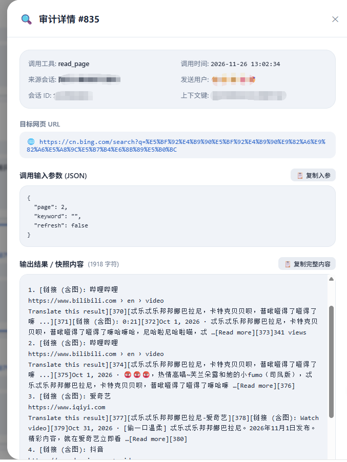
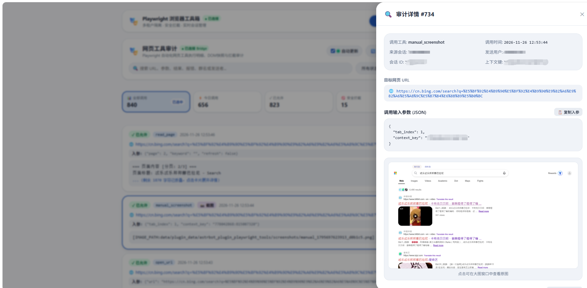

<div align="center">

# PlaywrightTool 


[](https://github.com/SmileYik/astrbot_plugin_playwright_tools)

基于 Playwright (首选 Camoufox 驱动) 的 AstrBot 网页浏览与自动化操作插件。  
为大模型提供低 Token 消耗、高精准度的元素编号（Ref ID）交互与长页面结构化阅读能力，具备完善的多租户隐私隔离、细粒度白名单防护与可视化运维审计。

</div>


## 🌟 特性亮点

- **元素编号精准操控**：自动为网页中的按钮、输入框等交互控件赋予编号，大模型按编号操作，降低 Token 消耗并提升点击准确率。
- **多标签页独立状态与自动切换**：每个标签页独立维护元素编号映射，支持查看已打开标签页列表与自动切换活动页，新开或切换标签页时主动提示。
- **结构化网页提炼与智能分页**：将长网页解析为保留排版、表格与控件的内联 Markdown 或无障碍语义树，支持长表格跨页排版与按页分批阅读。
- **长对话 Token 自动消减**：多步网页浏览后自动检测并消减冗长历史记录；支持副 AI 结合用户提问生成意图聚焦摘要，避免超长网页撑爆上下文。
- **拟真防反爬指纹伪装**：首选集成 Camoufox 防检测引擎，模拟真实人类浏览特征与时区地理位置，减少网站反爬拦截。
- **全面键鼠与多模态交互**：支持点击、输入、下拉选择、悬停、按键、滚动，以及视口高清截图、全页长截图与文件下载。
- **多租户隔离与安全防护**：支持个人私密浏览与群聊共享会话；管理员可统一配置域名白名单、单跳放行与访问权限，敏感密码输入框自动脱敏；权限受限时自动提示当前页可执行的操作。
- **内置可视化管理控制台**：提供基于 Material Design 3 的 Web 管理后台，直观检视历史浏览日志、网页快照与会话生命周期，支持一键导出与便捷维护。

---

## 📸 界面与效果预览

### 1. Web 审计控制台
直观展示全部调用、今日调用、已允许、安全拦截与执行异常统计，支持按关键词、状态与工具类型实时检索：


### 2. 详情审阅、快照与截图预览
点击任意审计卡片即可展开右侧抽屉，查看完整入参、结构化正文快照或网页实景截图：

| 内联 Markdown 快照效果 | 审计详情与网页截图预览 |
| :---: | :---: |
|  |  |

---

## 📦 安装部署与环境依赖

### 1. 环境要求
- Python 3.10+
- AstrBot v3.4.0+
- playwright v1.62.0

### 2. 依赖安装
推荐安装具备反反爬指纹伪装的 Camoufox 驱动：

```bash
pip install "camoufox[geoip]"
camoufox fetch
```

可以前往文档查看 [Camoufox](https://camoufox.com/python/installation/) 的更多安装信息。

若使用原生 Playwright 引擎（Chromium / Firefox / WebKit）：

```bash
pip install playwright
playwright install chromium
```

---

## 🎮 插件指令与配置说明

### 1. 聊天指令 (`/browser`)

用户与管理员可在聊天对话框中使用以下指令管理浏览器上下文：

| 指令 | 权限 | 说明 |
|---|---|---|
| `/browser invite <UID/@用户>` | 所有者 | 个人模式下，主动邀请目标用户以自己的权限协助操作当前浏览器 |
| `/browser use <UID/@用户>` | 已授权用户 | 显式切换至被邀请的浏览器上下文协同操作 |
| `/browser close` | 所有者 | 手动关闭并释放属于自己的浏览器上下文 |
| `/browser status` | 全员 | 查看当前绑定的浏览器活跃上下文、网页及标签页状态 |
| `/browser list` | 全员 | 列出当前会话内所有活跃的浏览器上下文 |
| `/browser list-all` | 管理员 | 查看全平台所有会话的活跃浏览器上下文 |
| `/browser kill <context_key>` | 管理员 | 强行关闭并释放指定的浏览器上下文资源 |

---

### 2. WebUI 配置说明 (`_conf_schema.json`)

配置已划分为 6 大业务分组，支持在 AstrBot WebUI 中折叠与展开：

#### ① 安全与权限 (`security`)
| 配置项 | 类型 | 默认值 | 作用描述 |
|---|---|---|---|
| `admin_only` | bool | `false` | 仅管理员可用：开启后仅机器人管理员与额外管理员可调用浏览器工具 |
| `extra_admin_uids` | list (`sender_id`) | `[]` | 额外管理员 UID 列表（支持平台用户选择器） |
| `storage_state_path` | string | `""` | 管理凭据路径：管理员专用的 Cookie / StorageState JSON 文件路径（仅管理员可用） |
| `whitelist_rules` | template_list | `[]` | 网站白名单：管理员设立的非管理员访问规则。支持域名通配（如 `*.bing.com`）与 12 项原子权限；放行时自动保留页面内部第三方资源 |
| `mask_password_inputs` | bool | `true` | 脱敏密码输入框：页面中 `type='password'` 的组件内容将被脱敏为 `******`，防止敏感信息泄露给大模型 |

#### ② 会话与运行时 (`runtime`)
| 配置项 | 类型 | 默认值 | 作用描述 |
|---|---|---|---|
| `context_mode` | string (select) | `"personal"` | 隔离模式：`personal` (个人隔离，每用户独享独立上下文) 或 `session` (会话共享，群聊/私聊共用) |
| `idle_timeout_minutes` | int (slider) | `10` | 空闲销毁时长：上下文无交互超过此时长后自动关闭以释放内存 (1~120 分钟) |
| `browser_idle_timeout_minutes` | int (slider) | `5` | 浏览器进程空闲退出：所有上下文关闭后，底层浏览器进程保持等待的最长空闲分钟数 (0~120 分钟，设为 0 表示常驻不退出) |
| `tool_execution_timeout_seconds` | int (slider) | `45` | 执行超时时长：单个工具执行的最长等待时间 (5~180 秒，建议 30~90 秒，避免慢站点临界超时) |
| `enable_close_tool` | bool | `true` | 注册关闭工具：是否向大模型注册主动关闭浏览器上下文的工具 |
| `system_prompt_injection` | text | `""` | 系统提示词注入：在调用大模型前动态注入自定义系统提示词，留空则不注入 |
| `content_extraction_mode` | string (select) | `"inline_markdown"` | 页面正文提炼模式：`inline_markdown` (内联交互 Markdown [推荐]) 或 `aria_snapshot` (无障碍语义树快照) |
| `page_chunk_char_limit` | int | `4000` | 分页字符预算：单页正文提炼的最大字符预算（建议 3000 ~ 6000，最小 500），增大预算可减少翻页次数 |

#### ③ 浏览器引擎 (`browser`)
| 配置项 | 类型 | 默认值 | 作用描述 |
|---|---|---|---|
| `browser_adapter` | string (select) | `"camoufox"` | 浏览器适配器：`camoufox` (防检测指纹伪装) 或 `playwright` (原生引擎) |
| `playwright_browser_type` | string (select) | `"chromium"` | Playwright 核心类型：`chromium`, `firefox`, `webkit`, `custom` (其他自定义路径) |
| `browser_executable_path` | string | `""` | 浏览器执行路径：自定义浏览器二进制文件的完整绝对路径（仅当核心类型为 `custom` 时必填） |
| `camoufox_geoip` | bool | `false` | GeoIP 定位防检：Camoufox 适配器是否根据 IP 自动模拟地理位置与时区 |
| `browser_headless` | bool | `true` | 无头模式：是否以无头模式后台静默运行浏览器 |
| `browser_window_width` | int | `1280` | 窗口宽度：浏览器初始视口宽度 (像素，常用桌面宽度建议 1280 或 1920) |
| `browser_window_height` | int | `800` | 窗口高度：浏览器初始视口高度 (像素，建议 720 ~ 1080，适当增高可减少首屏内容截断) |
| `browser_user_agent` | string | `""` | 自定义 UA：自定义 User-Agent，留空使用内置默认值 |

#### ④ 截图与交互输出 (`media`)
| 配置项 | 类型 | 默认值 | 作用描述 |
|---|---|---|---|
| `screenshot_format` | string (select) | `"png"` | 截图格式：`png` (无损高清) 或 `jpeg` (压缩优化) |
| `screenshot_quality` | int (slider) | `80` | 截图质量：JPEG 格式时的压缩质量 (1~100) |
| `screenshot_max_height_px` | int | `8000` | 长截图高度上限：全屏截取的最大像素高度，超出自动截断 |
| `screenshot_timeout_seconds` | int (slider) | `20` | 长截图超时时长：长截图拼接渲染超时秒数 (5~120 秒，建议 15~30 秒)，超时自动降级为视口截图 |
| `allow_screenshot_to_ai` | bool | `false` | 截图发送给 AI：是否允许将网页截图发送给大模型进行多模态视觉理解 |
| `element_multiline_separator` | string | `" \| "` | 元素换行替换符：页面可操作元素提取时内部换行符的替换连接符 |

#### ⑤ 存储与审计管理 (`storage_audit`, 默认折叠)
| 配置项 | 类型 | 默认值 | 作用描述 |
|---|---|---|---|
| `download_save_path` | string | `"data/plugin_data/astrbot_plugin_playwright_tools/downloads"` | 下载保存路径：浏览器下载文件保存的本地目录 |
| `screenshot_save_path` | string | `"data/plugin_data/astrbot_plugin_playwright_tools/screenshots"` | 截图保存路径：截图文件保存的本地目录 |
| `file_retention_days` | int | `7` | 文件保留天数：下载与截图文件保留天数，超期自动清理 |
| `audit_retention_days` | int | `14` | 审计保留天数：审计记录保存天数（建议 7 ~ 30），超期自动清理 |
| `audit_max_output_chars` | int | `0` | 审计字符上限：单条工具输出最大字符上限 (0 表示不限长度) |
| `audit_save_screenshots` | bool | `true` | 审计持久化截图：是否在审计数据库中关联保存截图文件 |

#### ⑥ 工具历史消减与压缩 (`history_cleanup`, 默认折叠)
| 配置项 | 类型 | 默认值 | 作用描述 |
|---|---|---|---|
| `enable_cleanup` | bool | `false` | 启用历史消减：开启后监控本插件工具调用字符并在超标时自动消减 |
| `high_watermark` | int | `24000` | 高水位阈值：历史工具调用总字符超过此时触发清理（建议 16000 ~ 40000） |
| `low_watermark` | int | `10000` | 低水位目标：触发清理后消减到的目标字符数（建议设为高水位的 30% ~ 50%） |
| `cleanup_strategy` | string (select) | `"delete"` | 消减策略：`delete` (直接占位清空) 或 `compress` (副 AI 总结提炼) |
| `compress_provider_id` | string | `""` | 压缩模型提供商：执行压缩提炼的 AI 提供商，留空使用会话默认模型 |
| `compress_max_input_chars` | int | `0` | 副 AI 输入上限：最大输入字符预算，0 代表不限制，如需截断建议 30000 ~ 60000 |
| `compress_prompt` | text | `"你是一个精炼的内容总结器..."` | 压缩提示词：副 AI 执行提炼时遵循的指导原则（默认输出不超过 1000 字的结构化摘要），支持 `{{user_input}}` 动态占位符 |
| `compress_use_persona` | bool | `false` | 启用人设面具：是否在压缩时注入人设设定 |
| `compress_persona_id` | string | `""` | 指定人设面具：用于压缩的人设面具，留空使用系统默认人设 |
| `include_compressed_in_watermark` | bool | `false` | 历史摘要计入水位：开启后此前已生成的历史摘要计入水位统计并参与滚动重压缩；关闭后不计入且不重复压缩 |

---

## 🧠 内置技能 (Built-in Skills)

插件内置了面向大模型的标准化操作技能文档：

- **`playwright-tool`** (`skills/playwright-tool/SKILL.md`)：  
  指导 AI 按照标准流程浏览网页、阅读结构化正文、检索关键词、应对页面遮挡弹层并执行精准元素交互。AstrBot 会在启用插件时自动识别并加载该技能。

---

## 🤖 大模型内置能力概览

插件为大模型注册了四个复合工具（与内置技能 `skills/playwright-tool/SKILL.md` 配合使用，无需手动配置参数）：

| 工具名称 | 主要用途 |
|---|---|
| `pw_page` | 打开网页、查看与切换标签页、响应浏览器弹窗、关闭浏览器上下文 |
| `pw_read` | 按页阅读结构化正文、关键词定位检索、查询元素真实链接与图片地址 |
| `pw_interact` | 点击、填表、下拉选择、悬停、聚焦、拖拽、按键与页面滚动 |
| `pw_media` | 视口截图、整页长截图（可发送至聊天或供 AI 识图）与文件下载 |

---

## 🛡️ 核心安全与协同机制设计理念

### 1. “邀请协助”机制 (`/browser invite`)
- **生效前提**：  
  仅在设置中将会话隔离配置为 `personal`（个人隔离模式）时有效。在 `session`（会话共享模式）下同一会话内所有成员本就共用同一浏览器，无需此功能。
- **核心逻辑与目的**：  
  由**被协助者（即浏览器上下文所有者）主动发起邀请**。其目的是让被邀请的协助者能够**以被协助者的权限和身份**，进入其个人浏览器上下文协助操作（例如协助排查网页故障、协助填写表单等）。
  - **主动授权**：未经所有者邀请的第三方无法主动介入或绑定他人上下文，整体流程严格由被协助者通过 `/browser invite <UID>` 显式授权。
  - **权限继承**：受邀协助者使用 `/browser use <UID>` 切换接入后，在该上下文内执行动作时继承被协助者的凭据与操作权限。
  - **权责分明**：系统审计日志中明确区分“会话所有者 (`owner_id`)”与“实际操作人 (`operator_id`)”，协同过程中的每步操作均精准留痕。

### 2. “白名单放行”机制 (`whitelist_rules`)
- **设立主体与适用对象**：  
  白名单规则由**管理员在后台自行设立与维护**，专门用于对非管理员用户（普通成员）的网页访问与操作行为进行安全规范；机器人管理员自身默认免检放行。
- **核心作用与资源放行特性**：  
  允许其他人在指定 URL 规则下正常访问网页内容。
  - **第三方资源不被屏蔽**：系统基于顶层页面导航请求（`is_navigation_request`）进行守卫拦截，仅对主框架跳转及新窗口进行白名单核验。对于页面内部加载的第三方资源、样式表、脚本、字体、图片及 API（典型情况如搜索引擎主站引入的外部静态资源或 CDN），**不会出现网页放行但内部资源被误屏蔽阻拦导致页面崩坏的情况**，保证网页排版正常与交互可用。
  - **通配符与精确度优先匹配**：支持通配域名规则（例如 `*.bing.com` 同时匹配根域名与所有子域名），当同时存在通配规则与精确子域名规则时，自动以更精确的域名规则为准，不依赖规则排列顺序。
  - **12 项原子化操作权限**：管理员在后台添加白名单规则时，可为每个域名独立勾选允许的操作（只读、点击、填表、下载等），实现细粒度行为控制。
  - **单跳放行机制 (`allow_single_hop`)**：管理员可按规则勾选“允许单跳放行”，允许该规则内的页面通过点击或弹窗等页面内操作跳转一次到非白名单页面；同时可独立配置单跳落地页允许执行的行为（如仅 `read`、`screenshot`）以及是否遵循 HTTP 重定向链。单跳落地页无法继续向其他非白名单地址跳转，回到白名单页面后自动恢复常规规则。

### 3. 白名单 12 种原子化操作权限对照表
管理员在 WebUI 的 `whitelist_rules` 规则中可针对特定域名按需勾选以下细分权限：

| 权限标识 | 归属工具 | 说明 |
|---|---|---|
| `read` | `pw_read` | 允许提取并读取页面结构化正文与交互元素列表 |
| `click` | `pw_interact` | 允许点击页面按钮、超链接等普通交互控件 |
| `fill` | `pw_interact` | 允许在页面表单输入框或文本域中键入文本内容 |
| `select` | `pw_interact` | 允许在下拉选择框 (`<select>`) 中选取选项 |
| `hover` | `pw_interact` | 允许鼠标悬停于指定元素上方以触发浮层菜单 |
| `focus` | `pw_interact` | 允许元素聚焦 (`focus`) 或失焦 (`blur`) 管理 |
| `drag` | `pw_interact` | 允许拖拽源元素并放置于目标元素处 |
| `press_key` | `pw_interact` | 允许向页面发送特定键盘按键（如 Enter、Escape） |
| `scroll` | `pw_interact` | 允许平滑滚动当前页面（支持向上或向下） |
| `screenshot` | `pw_media` | 允许截取并交付当前视口截图 |
| `screenshot_full` | `pw_media` | 允许进行整页长截图拼接与高度熔断截取 |
| `download` | `pw_media` | 允许触发指定元素的文件下载并将文件留存于本地 |

---

## 🏗️ 延伸文档

- **AI 工具能力与调用说明**：详见 [docs/AI_TOOLS.md](docs/AI_TOOLS.md)
- **跨插件共享浏览器服务接入指南**：详见 [docs/EXTERNAL_API.md](docs/EXTERNAL_API.md)
- **系统分层架构与模型设计**：详见 [docs/ARCHITECTURE.md](docs/ARCHITECTURE.md)
- **版本演进记录**：详见 [CHANGELOG.md](CHANGELOG.md)
