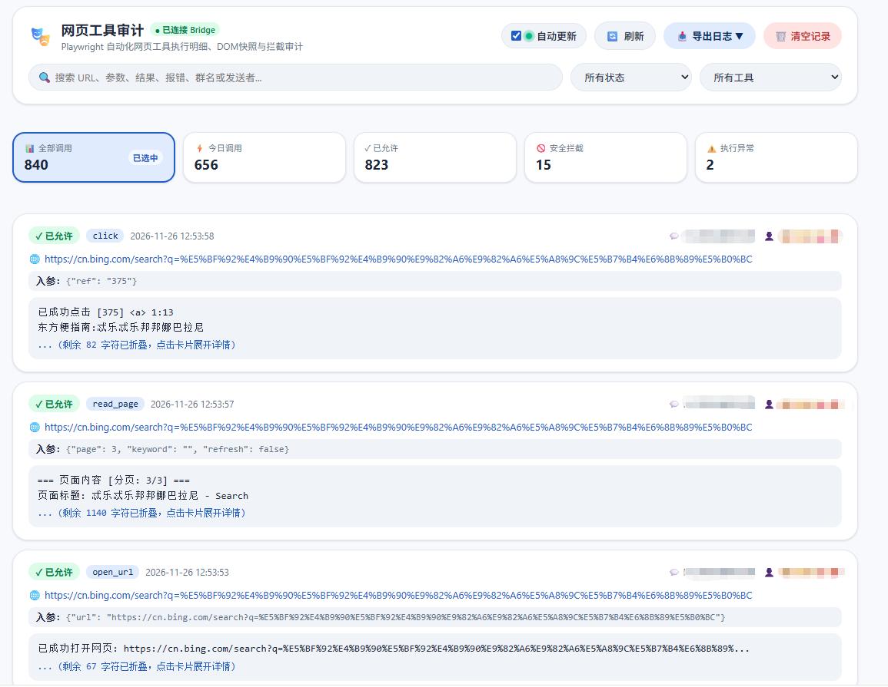

<div align="center">

# PlaywrightTool 


[](https://github.com/SmileYik/astrbot_plugin_playwright_tools)

基于 Playwright (首选 Camoufox 驱动) 的 AstrBot 网页浏览与自动化操作插件。  
为大模型提供低 Token 消耗、高精准度的元素编号（Ref ID）交互与长页面结构化阅读能力，具备完善的多租户隐私隔离、细粒度白名单防护与可视化运维审计。

</div>


## 🌟 特性亮点

- **四大聚合复合工具**：收敛为 `pw_page`、`pw_read`、`pw_interact`、`pw_media`，采用 AstrBot `FunctionTool` 原生强类型注册。
- **元素编号（Ref ID）与精准定位**：精简 DOM 并为所有可交互控件赋予自增编号（如原生引用风 `[登录][1]`、`[按钮: 登录][1]`），告别脆弱且高 Token 消耗的选择器，保证大模型定位精准度。
- **双正文提炼模式与长页智能分页**：
  - **内联交互 Markdown (Inline Markdown)**：默认推荐，将正文排版（标题、段落、列表、表格）、嵌入图片与带 Ref ID 的可交互控件内联熔合为原生引用风格 Markdown。支持长表格跨页智能截断与表头自动回填，Ref 元素全额计入预算以杜绝分页膨胀。
  - **无障碍语义树快照 (ARIA Snapshot)**：基于浏览器原生 Accessibility Tree 生成严密的语义角色层级树，剥离冗长 URL。
  - **自适应分页预算**：基于字符预算（`page_chunk_char_limit`）平滑切分超长文档，大模型可按页阅读或定向关键词检索。
- **纯双水位线工具历史消减与副 AI 压缩**：
  - **工具调用前置拦截与白名单机制**：在每次大模型准备调用工具前（`@filter.on_using_llm_tool`）精准触发，严格仅针对本插件四大核心工具（`pw_page`、`pw_read`、`pw_interact`、`pw_media`）进行白名单过滤。当前即将执行的工具输出天然免除，而同轮多步调用及历史轮次堆积的工具数据得到即时治理。
  - **高低双水位线管理**：当本插件工具累计字符超过高水位（`high_watermark`）时自动介入，从最旧轮次按 FIFO 退水直至回落至低水位（`low_watermark`），最新完成的工具调用自然保留在队尾供即时追问。
  - **直接删除与副 AI 智能压缩**：支持将旧工具内容替换为安全占位符，或唤起配置的副 AI 生成结构化事实摘要写回；绝不破坏 `tool_call_id` 配对骨架，杜绝 400 报错。
  - **人设面具融合与输入上限控制**：支持为副 AI 指定或默认继承系统人设面具；支持通过 `compress_max_input_chars` 设定副 AI 输入预算（0 为不限长度，大于 0 直接截断），并在副 AI 异常时自动降级为安全占位。
  - **事件流自动持久化与双重审计**：深度契合 AstrBot 上下文观察器机制，清理/压缩后的历史自动同步写回会话数据库，无二次重复压缩开销；具备全流程实时运行日志输出，并支持双重审计持久化（`context_lifecycle_logs` 生命周期事件与 `tool_audit_logs` 工具调用审计）。
- **全面键鼠交互与智能报错脱敏**：
  - 原生支持点击、输入、下拉选择、鼠标悬停（hover）、焦点管理（focus/blur）、元素拖拽（drag）、键盘按键及平滑滚动。
  - 自动剥离底层冗余指针跟踪日志，遇到超时、弹层遮挡时输出单行脱敏提示并自动附加下一步行动建议（`[推荐操作: ...]`）。
- **多租户隐私隔离与细粒度安全白名单**：
  - **个人模式 (`personal`)**：上下文相互隔离，支持由被协助者主动发起邀请授权好友以其权限协助操作，支持随时手动释放。
  - **会话模式 (`session`)**：同一会话内成员共享浏览器实例，适合多人公共讨论。
  - **安全白名单防护**：由管理员在后台统一设立规则，允许访问指定域名并按需绑定 12 项原子权限；页面放行时不会误屏蔽网页内部的第三方资源（如搜索引擎外部资源），保证网页正常浏览。
  - **密码防泄漏**：可开启密码输入框脱敏，自动将密码字段替换为 `******`。
- **底层浏览器进程智能回收与崩溃自愈**：
  - **进程级空闲回收**：支持配置无活跃上下文后底层浏览器驱动（Chromium / Camoufox）自动关闭（`browser_idle_timeout_minutes`），释放系统常驻内存，有新请求时透明按需拉起。
  - **异常崩溃感知自愈**：全链路监听浏览器底层断开事件（`disconnected`），在浏览器崩溃或意外退出时自动清理僵尸上下文并记录审计日志，保障后续调用透明恢复。
  - **停机熔断与双重退出兜底**：插件重载、禁用与退出时通过 `asyncio.gather` 并发 5.0 秒总超时熔断清理存量上下文，并结合 `atexit` 成对注册与注销机制，防范孤儿进程泄漏。
  - **全生命周期审计全覆盖**：对主动释放、超时回收、强制杀死及插件终止四个环节均记录规范化日志与包含存活时长、标签数、最终 URL 的结构化审计数据。
- **双重截图熔断机制**：支持视口截图与全页长截图；长截图具备最大像素高度限制（超限自动截断）与超时回退（超时降级为视口截图）。
- **统一 MD3 管理控制台与行为审计**：
  - 在 WebUI 后台提供基于 Material Design 3 大圆角风格的统一控制台面板（`views/browser/`），集成操作审计日志检视、DOM 快照与活跃会话生命周期运维管理。
  - 多维运维操作：支持按会话名、发送者、工具名、执行状态及正文关键词检索，支持将日志导出为 JSON 或 CSV，支持二次确认安全清空。

---

## 📦 安装部署与环境依赖

### 1. 环境要求
- Python 3.10+
- AstrBot v3.4.0+
- playwright v1.62.0

### 2. 依赖安装
推荐安装具备反反爬指纹伪装的 Camoufox 驱动：

```bash
pip install "camoufox[geoip]"
camoufox fetch
```

可以前往文档查看 [Camoufox](https://camoufox.com/python/installation/) 的更多安装信息。

若使用原生 Playwright 引擎（Chromium / Firefox / WebKit）：

```bash
pip install playwright
playwright install chromium
```

---

## 🎮 插件指令与配置说明

### 1. 聊天指令 (`/browser`)

用户与管理员可在聊天对话框中使用以下指令管理浏览器上下文：

| 指令 | 权限 | 说明 |
|---|---|---|
| `/browser invite <UID/@用户>` | 所有者 | 个人模式下，主动邀请目标用户以自己的权限协助操作当前浏览器 |
| `/browser use <UID/@用户>` | 已授权用户 | 显式切换至被邀请的浏览器上下文协同操作 |
| `/browser close` | 所有者 | 手动关闭并释放属于自己的浏览器上下文 |
| `/browser status` | 全员 | 查看当前绑定的浏览器活跃上下文、网页及标签页状态 |
| `/browser list` | 全员 | 列出当前会话内所有活跃的浏览器上下文 |
| `/browser list-all` | 管理员 | 查看全平台所有会话的活跃浏览器上下文 |
| `/browser kill <context_key>` | 管理员 | 强行关闭并释放指定的浏览器上下文资源 |

---

### 2. WebUI 配置说明 (`_conf_schema.json`)

配置已划分为 5 大业务分组，支持在 AstrBot WebUI 中折叠与展开：

#### ① 安全与权限 (`security`)
| 配置项 | 类型 | 默认值 | 作用描述 |
|---|---|---|---|
| `admin_only` | bool | `false` | 仅管理员可用：开启后仅机器人管理员与额外管理员可调用浏览器工具 |
| `extra_admin_uids` | list (`sender_id`) | `[]` | 额外管理员 UID 列表（支持平台用户选择器） |
| `storage_state_path` | string | `""` | 管理凭据路径：管理员专用的 Cookie / StorageState JSON 文件路径（仅管理员可用） |
| `whitelist_rules` | template_list | `[]` | 网站白名单：管理员设立的非管理员访问规则。支持域名通配（如 `*.bing.com`）与 12 项原子权限；放行时自动保留页面内部第三方资源 |
| `mask_password_inputs` | bool | `true` | 脱敏密码输入框：页面中 `type='password'` 的组件内容将被脱敏为 `******`，防止敏感信息泄露给大模型 |

#### ② 会话与运行时 (`runtime`)
| 配置项 | 类型 | 默认值 | 作用描述 |
|---|---|---|---|
| `context_mode` | string (select) | `"personal"` | 隔离模式：`personal` (个人隔离，每用户独享独立上下文) 或 `session` (会话共享，群聊/私聊共用) |
| `idle_timeout_minutes` | int (slider) | `10` | 空闲销毁时长：上下文无交互超过此时长后自动关闭以释放内存 (1~120 分钟) |
| `browser_idle_timeout_minutes` | int (slider) | `5` | 浏览器进程空闲退出：所有上下文关闭后，底层浏览器进程保持等待的最长空闲分钟数 (0~120 分钟，设为 0 表示常驻不退出) |
| `tool_execution_timeout_seconds` | int (slider) | `30` | 执行超时时长：单个工具执行的最长等待时间 (5~180 秒) |
| `enable_close_tool` | bool | `true` | 注册关闭工具：是否向大模型注册主动关闭浏览器上下文的工具 |
| `system_prompt_injection` | text | `""` | 系统提示词注入：在调用大模型前动态注入自定义系统提示词，留空则不注入 |
| `content_extraction_mode` | string (select) | `"inline_markdown"` | 页面正文提炼模式：`inline_markdown` (内联交互 Markdown [推荐]) 或 `aria_snapshot` (无障碍语义树快照) |
| `page_chunk_char_limit` | int (slider) | `2000` | 分页字符预算：单页正文提炼的最大字符预算 (500~8000)，超限自动平滑切分至下一页 |

#### ③ 浏览器引擎 (`browser`)
| 配置项 | 类型 | 默认值 | 作用描述 |
|---|---|---|---|
| `browser_adapter` | string (select) | `"camoufox"` | 浏览器适配器：`camoufox` (防检测指纹伪装) 或 `playwright` (原生引擎) |
| `playwright_browser_type` | string (select) | `"chromium"` | Playwright 核心类型：`chromium`, `firefox`, `webkit`, `custom` (其他自定义路径) |
| `browser_executable_path` | string | `""` | 浏览器执行路径：自定义浏览器二进制文件的完整绝对路径（仅当核心类型为 `custom` 时必填） |
| `camoufox_geoip` | bool | `false` | GeoIP 定位防检：Camoufox 适配器是否根据 IP 自动模拟地理位置与时区 |
| `browser_headless` | bool | `true` | 无头模式：是否以无头模式后台静默运行浏览器 |
| `browser_window_width` | int (slider) | `1280` | 窗口宽度：浏览器初始视口宽度 (800~3840 像素) |
| `browser_window_height` | int (slider) | `720` | 窗口高度：浏览器初始视口高度 (600~2160 像素) |
| `browser_user_agent` | string | `""` | 自定义 UA：自定义 User-Agent，留空使用内置默认值 |

#### ④ 截图与交互输出 (`media`)
| 配置项 | 类型 | 默认值 | 作用描述 |
|---|---|---|---|
| `screenshot_format` | string (select) | `"png"` | 截图格式：`png` (无损高清) 或 `jpeg` (压缩优化) |
| `screenshot_quality` | int (slider) | `80` | 截图质量：JPEG 格式时的压缩质量 (1~100) |
| `screenshot_max_height_px` | int (slider) | `8000` | 长截图高度上限：全屏截取的最大像素高度 (1000~30000 像素)，超出自动截断 |
| `screenshot_timeout_seconds` | int (slider) | `15` | 长截图超时时长：长截图拼接渲染超时秒数 (5~120 秒)，超时降级为视口截图 |
| `allow_screenshot_to_ai` | bool | `false` | 截图发送给 AI：是否允许将网页截图发送给大模型进行多模态视觉理解 |
| `element_multiline_separator` | string | `" \| "` | 元素换行替换符：页面可操作元素提取时内部换行符的替换连接符 |

#### ⑤ 存储与审计管理 (`storage_audit`, 默认折叠)
| 配置项 | 类型 | 默认值 | 作用描述 |
|---|---|---|---|
| `download_save_path` | string | `"data/downloads"` | 下载保存路径：浏览器下载文件保存的本地目录 |
| `screenshot_save_path` | string | `"data/screenshots"` | 截图保存路径：截图文件保存的本地目录 |
| `file_retention_days` | int (slider) | `7` | 文件保留天数：下载与截图文件保留天数 (1~90 天)，超期自动清理 |
| `audit_retention_days` | int (slider) | `30` | 审计保留天数：审计记录保存天数 (1~365 天)，超期自动清理 |
| `audit_max_output_chars` | int | `0` | 审计字符上限：单条工具输出最大字符上限 (0 表示不限长度) |
| `audit_save_screenshots` | bool | `true` | 审计持久化截图：是否在审计数据库中关联保存截图文件 |

---

## 🧠 内置技能 (Built-in Skills)

插件内置了面向大模型的标准化操作技能文档：

- **`playwright-tool`** (`skills/playwright-tool/SKILL.md`)：  
  指导 AI 按照标准流程浏览网页、阅读结构化正文、检索关键词、应对页面遮挡弹层并执行精准元素交互。AstrBot 会在启用插件时自动识别并加载该技能。

---

## 🛠️ 大模型工具规范 (LLM Tools Specification)

所有工具均通过 AstrBot `context.add_llm_tools` 类型化注册，统一命名为 `pw_*`：

### 1. `pw_page` (页面状态与生命周期控制)
管理页面的打开、标签页切换、原生对话框响应及上下文释放。

- **参数**：
  - `action` (string, 必填): 要执行的页面动作：`'open'`(打开网址) / `'switch_tab'`(切换标签页) / `'dialog'`(响应弹窗) / `'close'`(关闭当前浏览器上下文)
  - `url` (string, 可选): 网页地址 (action=`open` 时必填)
  - `tab_index` (integer, 可选): 要切换到的标签页序号，从 1 开始 (action=`switch_tab` 时必填)
  - `dialog_action` (string, 可选): 弹窗响应行为：`'accept'`(确认/确定) 或 `'dismiss'`(取消/拒绝) (action=`dialog` 时必填)
  - `prompt_text` (string, 可选): Prompt 弹窗的输入文本 (action=`dialog` 且为 prompt 时可选)

### 2. `pw_read` (结构化正文与快照阅读)
读取当前页面的结构化排版内容与可交互元素编号列表，支持多页分页与关键词定向定位。

- **参数**：
  - `page` (integer, 可选): 分页查看时的页码编号，从 1 开始 (默认为 1)
  - `keyword` (string, 可选): 页面内容关键词定位检索，若提供则返回包含关键词的上下文片段与相关元素
  - `ref` (string, 可选): 要查询详细信息或目标 URL 的元素 Ref 编号（如 `'1'`, `'2'`），传入时直接返回该 Ref 对应的类型、标题及完整链接/图片地址
  - `refresh` (boolean, 可选): 是否强制重新获取当前网页快照（例如等待动态内容加载完成或确认页面有最新更新时使用，默认为 `false`）

### 3. `pw_interact` (DOM 元素与键鼠交互)
针对页面快照中的 Ref ID 编号执行高精度键鼠操作。

- **参数**：
  - `action` (string, 必填): 要执行的交互动作：`'click'`(点击元素) / `'fill'`(输入文本) / `'select'`(下拉框选择) / `'hover'`(鼠标悬停) / `'focus'`(聚焦) / `'blur'`(失焦) / `'drag'`(拖拽至目标元素) / `'press_key'`(按键盘按键) / `'scroll'`(滚动页面)
  - `ref` (string, 可选): 目标元素在页面快照中的 Ref ID 编号 (除 press_key/scroll 外通常必填，支持纯数字 `'1'` 与语义标识 `'e1'`)
  - `text` (string, 可选): 输入文本内容 (action=`fill` 时必填)
  - `value` (string, 可选): 下拉框选中的选项值 (action=`select` 时必填)
  - `target_ref` (string, 可选): 拖拽放置的目标元素 Ref ID 编号 (action=`drag` 时必填)
  - `key` (string, 可选): 要发送的按键名称，如 `'Enter'`, `'Tab'`, `'Escape'`, `'ArrowDown'` (action=`press_key` 时必填)
  - `direction` (string, 可选): 滚动方向：`'down'`(向下) 或 `'up'`(向上) (action=`scroll` 时可选，默认 `'down'`)
  - `amount` (integer, 可选): 滚动像素距离 (action=`scroll` 时可选，默认 500)

### 4. `pw_media` (媒体交付与下载)
执行当前视口截图、全页面长截图或触发文件下载。

- **参数**：
  - `action` (string, 必填): 要执行的媒体动作：`'screenshot_viewport'`(当前视口截图) / `'screenshot_full'`(全页面长截图) / `'download'`(触发下载指定元素文件)
  - `target` (string, 可选): 交付目标：`'chat'`(发送至当前聊天会话) 或 `'ai'`(以 base64 形式交付供多模态大模型视觉理解，默认 `'chat'`)
  - `ref` (string, 可选): 触发下载的链接或按钮 Ref ID 编号 (action=`download` 时必填)

---

## 🛡️ 核心安全与协同机制设计理念

### 1. “邀请协助”机制 (`/browser invite`)
- **生效前提**：  
  仅在设置中将会话隔离配置为 `personal`（个人隔离模式）时有效。在 `session`（会话共享模式）下同一会话内所有成员本就共用同一浏览器，无需此功能。
- **核心逻辑与目的**：  
  由**被协助者（即浏览器上下文所有者）主动发起邀请**。其目的是让被邀请的协助者能够**以被协助者的权限和身份**，进入其个人浏览器上下文协助操作（例如协助排查网页故障、协助填写表单等）。
  - **主动授权**：未经所有者邀请的第三方无法主动介入或绑定他人上下文，整体流程严格由被协助者通过 `/browser invite <UID>` 显式授权。
  - **权限继承**：受邀协助者使用 `/browser use <UID>` 切换接入后，在该上下文内执行动作时继承被协助者的凭据与操作权限。
  - **权责分明**：系统审计日志中明确区分“会话所有者 (`owner_id`)”与“实际操作人 (`operator_id`)”，协同过程中的每步操作均精准留痕。

### 2. “白名单放行”机制 (`whitelist_rules`)
- **设立主体与适用对象**：  
  白名单规则由**管理员在后台自行设立与维护**，专门用于对非管理员用户（普通成员）的网页访问与操作行为进行安全规范；机器人管理员自身默认免检放行。
- **核心作用与资源放行特性**：  
  允许其他人在指定 URL 规则下正常访问网页内容。
  - **第三方资源不被屏蔽**：系统基于顶层页面导航请求（`is_navigation_request`）进行守卫拦截，仅对主框架跳转及新窗口进行白名单核验。对于页面内部加载的第三方资源、样式表、脚本、字体、图片及 API（典型情况如搜索引擎主站引入的外部静态资源或 CDN），**不会出现网页放行但内部资源被误屏蔽阻拦导致页面崩坏的情况**，保证网页排版正常与交互可用。
  - **通配符支持**：支持通配域名规则（例如 `*.bing.com` 同时匹配根域名与所有子域名）。
  - **12 项原子化操作权限**：管理员在后台添加白名单规则时，可为每个域名独立勾选允许的操作（只读、点击、填表、下载等），实现细粒度行为控制。

### 3. 白名单 12 种原子化操作权限对照表
管理员在 WebUI 的 `whitelist_rules` 规则中可针对特定域名按需勾选以下细分权限：

| 权限标识 | 归属工具 | 说明 |
|---|---|---|
| `read` | `pw_read` | 允许提取并读取页面结构化正文与交互元素列表 |
| `click` | `pw_interact` | 允许点击页面按钮、超链接等普通交互控件 |
| `fill` | `pw_interact` | 允许在页面表单输入框或文本域中键入文本内容 |
| `select` | `pw_interact` | 允许在下拉选择框 (`<select>`) 中选取选项 |
| `hover` | `pw_interact` | 允许鼠标悬停于指定元素上方以触发浮层菜单 |
| `focus` | `pw_interact` | 允许元素聚焦 (`focus`) 或失焦 (`blur`) 管理 |
| `drag` | `pw_interact` | 允许拖拽源元素并放置于目标元素处 |
| `press_key` | `pw_interact` | 允许向页面发送特定键盘按键（如 Enter、Escape） |
| `scroll` | `pw_interact` | 允许平滑滚动当前页面（支持向上或向下） |
| `screenshot` | `pw_media` | 允许截取并交付当前视口截图 |
| `screenshot_full` | `pw_media` | 允许进行整页长截图拼接与高度熔断截取 |
| `download` | `pw_media` | 允许触发指定元素的文件下载并将文件留存于本地 |

---

## 🏗️ 系统架构与延伸文档

- **跨插件共享浏览器服务接入指南**：详见 [docs/EXTERNAL_API.md](docs/EXTERNAL_API.md)
- **系统分层架构与模型设计**：详见 [docs/ARCHITECTURE.md](docs/ARCHITECTURE.md)
- **开发与协作规范**：详见 [AGENT.md](AGENT.md)
- **版本演进记录**：详见 [CHANGELOG.md](CHANGELOG.md)



<details>
<summary>更多截图</summary>


</details>
