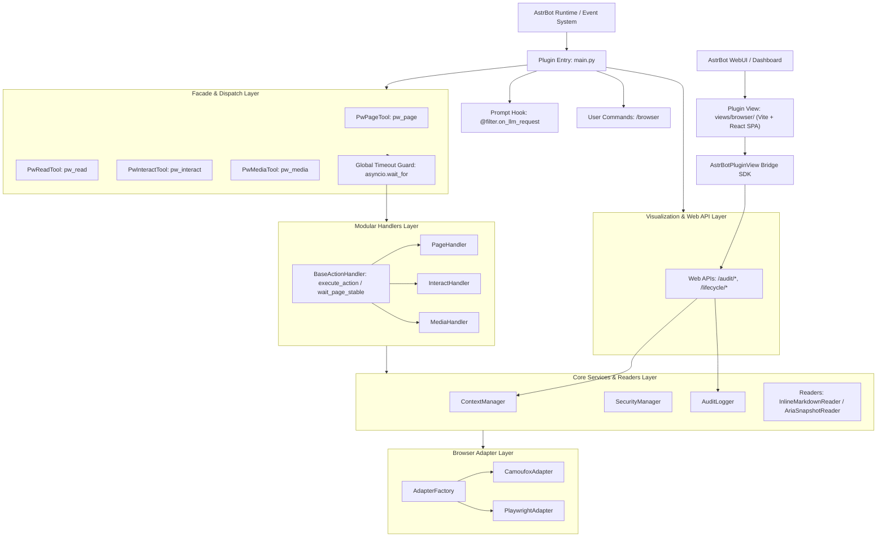
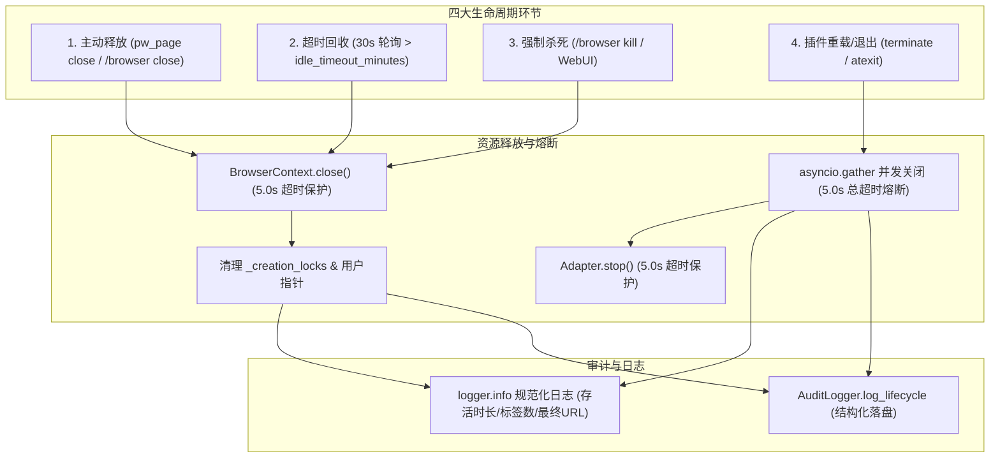

# 插件系统架构设计 (Architecture)

本文档阐明 `astrbot_plugin_playwright_tools` 的系统分层架构、并发与隔离模型、元素定位、安全与稳定性机制以及平台合规规范。

---

## 1. 系统分层架构

系统遵循关注点分离原则，采用清晰的五层分层模型：



### 1.1 适配器层 (`adapts/`)
- **`AdapterFactory`**: 统一构建浏览器适配器实例，依据配置选择 `camoufox` 或原生 `playwright` 驱动，并负责校验自定义浏览器二进制可执行路径。
- **`CamoufoxAdapter`**: 封装 Playwright 与 Camoufox 驱动的启动、销毁与高级反反爬指纹伪装，支持可选的 GeoIP 定位防检。
- **`PlaywrightAdapter`**: 封装 Playwright 原生驱动（Chromium / Firefox / WebKit / Custom），支持自定义二进制路径，负责底层进程生命周期。

### 1.2 核心服务与提炼层 (`core/`, `core/readers/`)
- **`ContextManager`**: 管理多租户 `BrowserSessionContext` 实例。负责个人模式与会话模式的上下文隔离路由、协作者授权、Cookie 注入、空闲定时回收、维护单调递增的 Ref 编号计数器，并在创建上下文异常时自动执行回滚清理。同时负责底层浏览器进程生命周期的智能空闲回收（无活跃上下文超过 `browser_idle_timeout_minutes` 自动关闭底层驱动）、崩溃失联事件（`disconnected`）感知自愈，以及在插件终止时通过并发 5.0 秒总超时熔断机制批量注销存量上下文。
- **`SecurityManager`**: 权限与白名单守卫。执行域名通配符匹配（如 `*.bing.com`）、12 项原子动作权限细粒度校验，在页面创建和路由阶段拦截未授权顶层跳转、弹出新窗口与 iframe 导航，同时对放行网页自动保留内部第三方静态资源的正常加载。
- **`AuditLogger`**: SQLite 审计记录器。异步记录全量调用（起止时间、会话、上下文、目标域名、入参与结果），并在初始化与周期轮询中自动清理超期数据。
- **`readers/`（双阅读提炼器）**:
  - **`InlineMarkdownReader`**: 将网页标题、段落、列表、表格、图片及带 Ref ID 的控件融合成语义清晰的 Markdown 文档，对普通图片与超链接统一隐藏原始 URL 并注入单调递增编号 `data-astr-ref="{ref}"`，支持字符预算（`page_chunk_char_limit`）平滑分页与通过 `pw_read(ref=...)` 按需结构化查询目标 URL。
  - **`AriaSnapshotReader`**: 原生调用 Playwright 官方 `page.locator(':root').aria_snapshot(mode='ai')` 生成标准化无障碍树快照，彻底过滤并剥离 `- /url: <url>` 子行与末尾多余冒号，对超链接无障碍名称本身为 URL 的情况自动化简为 `link [ref=...]`；并发拉取图片元素的真实 `src` 并关联父级嵌套超链接，产出与 Markdown 模式完全对齐的标准 `ref_map` 契约，原生支持 `pw_read(ref=...)` 结构化查询。

### 1.3 处理器层 (`tools/handlers/`)
- **`BaseActionHandler`**: 动作执行切面基类。通过模板方法 `execute_action()` 统一收敛核心横切逻辑：
  - 上下文寻址与活跃状态校验；
  - 基于 `SecurityManager` 进行动作权限与域名白名单预检；
  - 页面稳定等待保护（`wait_page_stable`）；
  - 密码输入全链路脱敏（若 `mask_password_inputs=True`，探测 `type == 'password'` 并将入参脱敏为 `******` 记录审计和日志）；
  - Playwright 底层错误清洗（`clean_playwright_error`），保留错误调用栈并记录错误审计；
  - 审计日志全量落盘与返回结果格式化。
- **`PageHandler`**: 页面生命周期与导航（打开 URL、标签页切换、原生对话框响应与上下文主动关闭），继承 `BaseActionHandler`。
- **`InteractHandler`**: 原生 Locator 键鼠与表单交互（点击、输入、选择、鼠标悬停、焦点管理、元素拖拽、键盘按键及滚动），继承 `BaseActionHandler`，支持双定位策略及密码脱敏。
- **`MediaHandler`**: 视口与长截图生成及下载，实施双重熔断（最大高度限制与超时回退为视口截图），处理持久化审计截图，继承 `BaseActionHandler`。

### 1.4 门面分发层 (`tools/tools.py`, `tools/schemas.py`)
- **`PwPageTool` / `PwReadTool` / `PwInteractTool` / `PwMediaTool`**: 继承 `FunctionTool[AstrAgentContext]` 的类型化工具门面，面向大模型暴露四大独立复合工具。
- 每个工具在初始化时维护 `_actions` 字典映射，统一采用字符串格式 Ref ID 参数；`call()` 统一设计为标准协程，并通过 `_execute_with_timeout` 施加全局单工具超时保护。
- 在发送聊天截图时，使用异步方法交付，避免后续文本消息覆盖聊天界面图片。

### 1.5 可视化视图与 Web API 层 (`views/browser/`, `web-src/`, `main.py`, `api/`)
- **独立页面声明 (`metadata.yaml`)**：注册 `target: plugin_page` 视图 `browser`（网页工具控制台），由 WebUI 宿主统一加载展示。
- **轻量 MD3 前端架构 (`web-src/`)**：基于 Vite + React 18 + TypeScript 构建，自适应宿主深浅色主题，遵循 Material Design 3 大圆角（16-24px）与表面色规范。基于内部内存路由无缝切换“操作审计”与“会话生命周期”面板，侧边抽屉支持检视全量 JSON 入参、DOM 快照与截图。
- **后端模块化 Web API (`api/audit_api.py`, `api/lifecycle_api.py`)**：通过 `context.register_web_api` 注册 `/{PLUGIN_NAME}/audit/*`（多维条件检索、指标统计、导出、清空、截图预览）与 `/{PLUGIN_NAME}/lifecycle/*`（活跃上下文列表、生命周期日志检索、上下文强制终止、手动截图）。所有接口复用 AstrBot WebUI 原生登录鉴权。

---

## 2. 隔离与多租户模型

```
[Personal Mode]
Session S1 ──> User U1 ──> Context (Owner: U1, SharedWith: [U2])
          ──> User U2 ──> Context (Owner: U2)
                       └─ (Can switch to U1's context via /browser use U1)

[Session Mode]
Session S1 ──> All Users share Context (Owner: S1)
```

1. **个人模式 (`personal`)**：默认以 `session_id:sender_id` 作为上下文标识，各用户数据、Cookie 与页面隔离。支持被协助者（所有者）通过 `/browser invite <UID>` 主动发起邀请授权好友；被授权用户可通过 `/browser use <UID>` 切换至该上下文，以被协助者的权限与身份协同操作。
2. **会话模式 (`session`)**：同一会话共享浏览器实例，所有成员共用上下文。
3. **白名单与特权防护**：白名单由管理员统一在后台设立并绑定 12 项原子权限，非管理员受白名单约束，放行页面时不拦截网页内部第三方静态资源；预配置的 Cookie / StorageState 仅对管理员创建的上下文生效，普通用户上下文保持纯净无凭据隔离。

---

## 3. 元素定位与交互可靠性

- **Ref ID 字符串化与单调递增**：所有工具入参（`ref`、`target_ref`）、上下文 `ref_map` 均统一采用字符串类型。Markdown 模式采用单调递增计数器（递增上限 1,000,000 后安全回滚至 0），避免历史 Ref ID 冲突。
- **双定位器策略**：
  - **ARIA 快照模式**：当 Ref ID 为官方格式标识（如 `e1`）或由 ARIA 模式生成时，使用 Playwright 原生选择器 `page.locator(f"aria-ref={ref}")` 执行定位。
  - **内联 Markdown 模式**：当 Ref ID 为数字编号（如 `'1'`）时，使用 `page.locator(f'[data-astr-ref="{ref}"]')` 执行定位。
  - 两种方式均基于 Playwright 原生 Locator 体系，享有框架自带的可操作性检查与受控组件事件分发。
- **全链路密码安全脱敏**：表单填入敏感信息时，根据元素属性探测 `type == 'password'`，开启配置后在审计记录、调用日志与大模型返回结果中均将敏感密码值替换为 `******`，防止凭据泄露。

---

## 4. 页面稳定等待与四重快照失效机制

- **页面就绪等待守卫 (`wait_page_stable`)**：在页面导航或关键交互后，依次执行两阶段等待：
  1. 等待 `domcontentloaded`（超时 10s）；
  2. 执行 `networkidle` 限时守卫（1.5s 超时熔断）。针对长轮询、WebSocket 或媒体流持续产生网络请求的现代网页，超时后平滑降级放行，避免流程卡死。
- **四重快照失效机制**：
  1. **路由导航监听**：监听主 Frame 的 `framenavigated` 事件，一旦主页面发生跳转，立即将上下文标记为 `is_snapshot_dirty = True` 并清空旧快照与 `ref_map`；
  2. **URL 状态比对**：在 `read_page` 提炼前，比对当前 `page.url` 与快照 URL，若不一致则标记脏并重置；
  3. **交互状态脏标记**：在 `InteractHandler` 中执行任何具有副作用的交互操作后，将 `ctx.is_snapshot_dirty = True`；
  4. **TTL 时效衰减**：快照记录生成时间戳 `timestamp`，超过 60 秒有效期后自动失效重新提取。

---

## 5. 浏览器生命周期、上下文回滚与资源安全

### 5.1 上下文创建异常回滚
`ContextManager._create_new_context` 采用生命周期安全保护：在申请底层 `BrowserContext` 之后，后续的路由守卫挂载、首页面创建、事件监听注册等步骤若发生任何异常，均在 `try...except` 中捕获并立即调用 `await browser_ctx.close()`，清理孤儿上下文，避免资源泄漏。同时针对并发创建场景引入单上下文键粒度的异步排队互斥锁（`_creation_locks`），保证相同租户 key 下仅创建一个实例。

### 5.2 四大生命周期环节全覆盖与审计闭环
系统在全链路中对上下文资源的四个关键流转环节实施了资源释放、运行日志（`logger.info`）与结构化审计记录（`AuditLogger.log_lifecycle`）：
1. **主动释放 (User / LLM Close)**：
   - 触发入口：用户调用 `/browser close` 或大模型调用 `pw_page(action='close')`。
   - 资源流转：从 `contexts` 映射中移除，带 5 秒超时执行 `browser_context.close()`，清理创建互斥锁与协作者指针，更新归零时间戳 `last_zero_context_time`。
   - 审计与指标：记录 `close` 事件类型，结构化记入 `duration_seconds`（存活秒数）、`tab_count`（关闭时标签页数）与 `final_url`（关闭时最终 URL）。
2. **超时回收 (Idle Context Reclamation)**：
   - 触发入口：主插件后台周期轮询任务（每 30 秒执行一次 `cleanup_idle_contexts()`）。
   - 资源流转：逐一比对上下文无操作空闲时长是否超过 `idle_timeout_minutes`，超期后安全关闭底层上下文并释放相关状态。
   - 审计与指标：记录 `timeout` 事件类型，记入 `idle_minutes`、`duration_seconds`、`tab_count` 与 `final_url`。
3. **强制杀死 (Force Kill / Revocation)**：
   - 触发入口：管理员调用 `/browser kill <key>` 或 WebUI 控制台发起强退请求。
   - 资源流转：在 `force_kill_context` 中剔除映射并实施 5 秒超时保护强制关闭，清理上下文关联的协作者共享指针与互斥锁。
   - 审计与指标：记录 `kill` 事件类型，记入 `operator`、`duration_seconds`、`tab_count` 与 `final_url`。
4. **插件重载与终止 (Plugin Terminate / Reload / atexit)**：
   - 触发入口：插件卸载、重载、禁用或宿主进程退出。
   - 资源流转：在 `main.py: terminate()` 中首先成对注销 `atexit.unregister(self._atexit_cleanup)` 避免重复触发；随后通过 `ContextManager.close_all_contexts(reason="terminate")` 借助 `asyncio.gather` 并发关闭所有存量上下文，施加 5.0 秒总超时熔断；最后以 5.0 秒超时安全执行 `adapter.stop()`。
   - 异常兜底：若宿主异常终止未正常流经 `terminate()`，通过 `atexit.register` 注册的同步/异步清理钩子实施兜底资源释放。
   - 审计与指标：记录 `terminate` 事件类型，附带 `reason` 与存活及页面指标。



### 5.3 底层浏览器进程空闲自动回收与自愈
- **底层进程空闲自动回收**：
  - 底层 Chromium/Camoufox 进程在上下文归零后若持续常驻后台将占用较多系统内存。
  - 本系统在 `ContextManager` 中维护 `last_zero_context_time` 时间戳。当所有活跃上下文归零后开始计时；主插件后台 30 秒轮询调用 `check_and_cleanup_idle_browser()`。
  - 当归零持续时间达到配置的 `browser_idle_timeout_minutes`（默认 5 分钟，若配置为 0 则保持常驻），自动调用 `adapter.stop()` 优雅关闭底层浏览器驱动进程，释放系统常驻内存。
  - 当后续再次有会话发起页面访问时，Adapter 在 `create_context` 中依据 `if not self.is_running` 自动透明重新拉起浏览器实例，上层调用无感。
- **底层浏览器崩溃失联感知与自愈**：
  - 浏览器可能因操作系统 OOM 或外部信号被强制关闭，导致 CDP 处于假死僵尸态。
  - 适配器层监听 Playwright 底层 `disconnected` 事件，并向 `ContextManager` 触发断开回调。
  - `ContextManager._on_browser_disconnected` 收到通知后，立即清空存量僵死上下文映射并清理互斥锁，向审计系统记录 `terminate (reason="browser_crash")`。
  - 后续请求将透明触发适配器重新启动新浏览器进程，恢复系统服务可用性。

---

## 6. 平台合规设计 (Platform Compliance)

- **专属数据持久化路径**：遵循 AstrBot 插件持久化规范，所有产生的文件统一收敛至 `data/plugin_data/astrbot_plugin_playwright_tools/`：
  - 审计数据库：`data/plugin_data/astrbot_plugin_playwright_tools/audit.db`
  - 文件下载目录：`data/plugin_data/astrbot_plugin_playwright_tools/downloads/`
  - 临时截图目录：`data/plugin_data/astrbot_plugin_playwright_tools/screenshots/`
  - 审计截图目录：`data/plugin_data/astrbot_plugin_playwright_tools/audit_screenshots/`
- **统一 Logger 规范**：全插件模块严格使用 AstrBot 官方标准的 `from astrbot.api import logger` 获取日志器，移除标准库 `logging` 的回退引入，保证与宿主运行环境的日志格式和输出通道一致。

---

## 7. 扩展规范

若需为现有工具扩展动作（Action）或新增复合工具：
1. **Schema 扩展**：在 `tools/schemas.py` 中更新对应工具的 `action` 枚举及字段定义，`ref` 字段统一为 `string` 类型。
2. **Handler 实现**：在 `tools/handlers/` 相应模块中编写动作逻辑，统一继承 `BaseActionHandler` 并通过 `execute_action()` 分发调度。
3. **门面转发**：在 `tools/tools.py` 对应工具中实现私有动作方法，并注册进 `self._actions` 映射表中。
4. **单测覆盖**：在 `tests/` 中编写针对新动作的单元测试。
