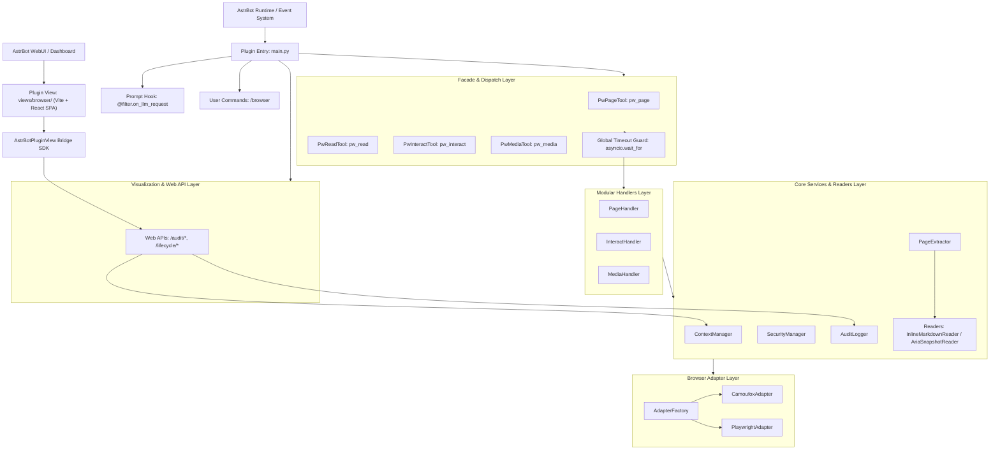

# 插件系统架构设计 (Architecture)

本文档阐明 `astrbot_plugin_playwright_tools` 的系统分层架构、并发与隔离模型、安全防护及扩展规范。

---

## 1. 系统分层架构

系统遵循关注点分离原则，采用清晰的五层分层模型：



### 1.1 适配器层 (`adapts/`)
- **`AdapterFactory`**: 统一构建浏览器适配器实例，依据配置选择 `camoufox` 或原生 `playwright` 驱动，并负责校验自定义浏览器二进制可执行路径。
- **`CamoufoxAdapter`**: 封装 Playwright 与 Camoufox 驱动的启动、销毁与高级反反爬指纹伪装，支持可选的 GeoIP 定位防检。
- **`PlaywrightAdapter`**: 封装 Playwright 原生驱动（Chromium / Firefox / WebKit / Custom），支持自定义二进制路径，负责底层进程生命周期。

### 1.2 核心服务与提炼层 (`core/`, `core/readers/`)
- **`ContextManager`**: 管理多租户 `ManagedContext` 实例。负责个人模式与会话模式的上下文隔离路由、协作者授权、Cookie 注入以及空闲定时回收。
- **`SecurityManager`**: 权限与白名单守卫。执行域名通配符匹配（如 `*.github.com`）、动作权限细粒度校验，以及在页面创建时拦截未授权顶层跳转、弹出新窗口与 iframe 导航。
- **`AuditLogger`**: SQLite 审计记录器。异步记录全量调用（起止时间、会话、上下文、目标域名、入参与结果），并在初始化与周期轮询中自动清理超期数据。
- **`PageExtractor` 与 `readers/`**: 
  - `PageExtractor`: 提取器单例入口，无状态维护提取流程，为可交互 DOM 节点打上 `data-astr-ref="{idx}"` 属性，支持关键词检索过滤与快照缓存。
  - `InlineMarkdownReader`: 将网页标题、段落、列表、表格及带 Ref ID 的控件融合成语义清晰的 Markdown 文档，支持字符预算（`page_chunk_char_limit`）平滑分页。
  - `AriaSnapshotReader`: 基于浏览器无障碍树生成严密的语义角色层级快照。

### 1.3 处理器层 (`tools/handlers/`)
- **`PageHandler`**: 页面生命周期与导航（打开 URL、标签页切换、原生对话框响应与上下文主动关闭）。
- **`InteractHandler`**: 原生 Locator 交互逻辑（点击、输入、选择、鼠标悬停、焦点管理、元素拖拽、键盘按键及滚动），基于 `data-astr-ref` 定位并自动脱敏错误与生成下一步推荐指引。
- **`MediaHandler`**: 视口与长截图生成及下载，实施双重熔断（最大高度限制与超时回退为视口截图），处理持久化审计截图。

### 1.4 门面分发层 (`tools/tools.py`, `tools/schemas.py`)
- **`PwPageTool` / `PwReadTool` / `PwInteractTool` / `PwMediaTool`**: 继承 `FunctionTool[AstrAgentContext]` 的类型化工具门面，面向大模型暴露四大独立复合工具。
- 每个工具在初始化时维护 `_actions` 字典映射，移除 `if-elif-else` 分支；`call()` 统一设计为标准协程，并通过 `_execute_with_timeout` 施加全局单工具超时保护。
- 在发送聊天截图时，使用异步方法交付，避免后续文本消息覆盖聊天界面图片。

### 1.5 可视化视图与 Web API 层 (`views/browser/`, `web-src/`, `main.py`, `api/`)
- **独立页面声明 (`metadata.yaml`)**：注册 `target: plugin_page` 视图 `browser`（网页工具控制台），由 WebUI 宿主统一加载展示。
- **轻量 MD3 前端架构 (`web-src/`)**：基于 Vite + React 18 + TypeScript 构建，自适应宿主深浅色主题，遵循 Material Design 3 大圆角（16-24px）与表面色规范。基于内部内存路由无缝切换“操作审计”与“会话生命周期”面板，侧边抽屉支持检视全量 JSON 入参、DOM 快照与截图。
- **后端模块化 Web API (`api/audit_api.py`, `api/lifecycle_api.py`)**：通过 `context.register_web_api` 注册 `/{PLUGIN_NAME}/audit/*`（多维条件检索、指标统计、导出、清空、截图预览）与 `/{PLUGIN_NAME}/lifecycle/*`（活跃上下文列表、生命周期日志检索、上下文强制终止、手动截图）。所有接口天然复用 AstrBot WebUI 原生登录鉴权。

---

## 2. 隔离与多租户模型

```
[Personal Mode]
Session S1 ──> User U1 ──> Context (Owner: U1, SharedWith: [U2])
          ──> User U2 ──> Context (Owner: U2)
                       └─ (Can switch to U1's context via /browser use U1)

[Session Mode]
Session S1 ──> All Users share Context (Owner: S1)
```

1. **个人模式 (`personal`)**：默认以 `session_id:sender_id` 作为上下文标识，各用户数据、Cookie 与页面完全隔离。
2. **协作切换**：所有者可通过 `/browser invite <UID>` 授权好友；被授权用户可通过 `/browser use <UID>` 主动切换绑定目标上下文。
3. **特权防护**：预配置的 Cookie / StorageState 仅对管理员创建的上下文生效，普通用户上下文保持纯净无凭据隔离。

---

## 3. 元素定位与交互可靠性

- **Ref ID 生成**：通过 `document.body` 遍历可操作节点（`a`, `button`, `input`, `select`, `textarea` 等），写入 `data-astr-ref="{idx}"`。
- **元素查找**：所有交互操作（点击、悬停、聚焦、拖拽等）均基于 Playwright 原生定位器 `locator('[data-astr-ref="{ref}"]')` 执行，全面享受框架自带的可操作性检查与受控组件事件分发，避免传统裸 JS 注入匹配失败。

---

## 4. 扩展规范

若需为现有工具扩展动作（Action）或新增复合工具：
1. **Schema 扩展**：在 `tools/schemas.py` 中更新对应工具的 `action` 枚举及字段定义。
2. **Handler 实现**：在 `tools/handlers/` 相应模块中编写底层逻辑，并在执行前后记录 `audit_logger.log_action`。
3. **门面转发**：在 `tools/tools.py` 对应工具中实现私有动作方法，并注册进 `self._actions` 映射表中。
4. **单测覆盖**：在 `tests/` 中编写针对新动作的单元测试。
