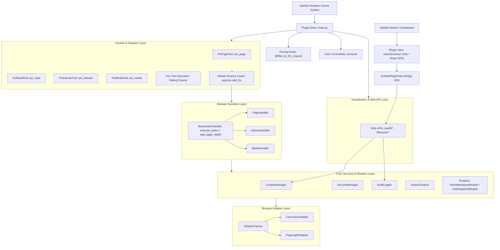
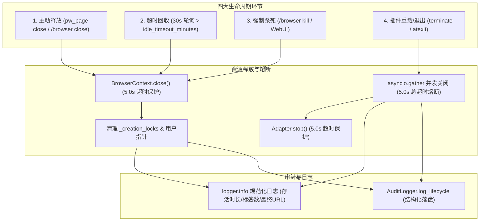

# 插件系统架构设计 (Architecture)

本文档阐明 `astrbot_plugin_playwright_tools` 的系统分层架构、并发与隔离模型、元素定位、安全与稳定性机制以及平台合规规范。

---

## 1. 系统分层架构

系统遵循关注点分离原则，采用清晰的五层分层模型：



### 1.1 适配器层 (`adapts/`)
- **`AdapterFactory`**: 统一构建浏览器适配器实例，依据配置选择 `camoufox` 或原生 `playwright` 驱动，并负责校验自定义浏览器二进制可执行路径。
- **`CamoufoxAdapter`**: 封装 Playwright 与 Camoufox 驱动的启动、销毁与高级反反爬指纹伪装，支持可选的 GeoIP 定位防检。
- **`PlaywrightAdapter`**: 封装 Playwright 原生驱动（Chromium / Firefox / WebKit / Custom），支持自定义二进制路径，负责底层进程生命周期。

### 1.2 核心服务与提炼层 (`core/`, `core/readers/`)
- **`ContextManager`**: 管理多租户 `BrowserSessionContext` 实例。负责个人模式与会话模式的上下文隔离路由、协作者授权、Cookie 注入、空闲定时回收、按标签页隔离维护 `PageState`（`ref_map`、`current_snapshot`、`is_snapshot_dirty`）及跨标签页 `ref_id` 自动寻址与激活，并维护上下文级单调递增的 Ref 编号计数器；在创建上下文异常时自动执行回滚清理。同时负责底层浏览器进程生命周期的智能空闲回收（无活跃上下文超过 `browser_idle_timeout_minutes` 自动关闭底层驱动）、崩溃失联事件（`disconnected`）感知自愈，以及在插件终止时通过并发 5.0 秒总超时熔断机制批量注销存量上下文。
- **`SecurityManager`**: 权限与白名单守卫。执行基于域名精确度优先的白名单规则匹配（精确域名优先于深层通配及浅层通配）、12 项原子动作权限细粒度校验，以及单跳放行策略解析。
- **`NavigationGuard`** (`core/navigation_guard.py`): 独立的顶层导航路由守卫与单跳授权状态管理器。从 `ContextManager` 解耦而出，负责挂载 `BrowserContext` 路由拦截与页面/弹窗监听，维护标签页（`Page`）粒度的 `SingleHopGrant` 状态，区分页面内点击/弹窗单跳、HTTP 重定向链以及 AI 主动 `open_url` 导航。
- **`AuditLogger`**: SQLite 审计记录器。异步记录全量调用（起止时间、会话、上下文、目标域名、入参与结果），并在初始化与周期轮询中自动清理超期数据。
- **`HistoryCleaner`**: 上下文历史清理器。基于高低双水位线在请求发送前自动消减已产生的工具调用记录，支持直接清理与副 AI 紧凑事实摘要压缩，配合 `AuditLogger` 实现工具调用与生命周期双重审计落盘。
- **`readers/`（双阅读提炼器）**:
  - **`InlineMarkdownReader`**: 将网页标题、段落、列表、表格、图片及带 Ref ID 的控件融合成语义清晰的 Markdown 文档；底层 DOM 提炼逻辑与 Python 独立解耦（位于 `core/readers/markdown_extractor.js`），内联控件排版采用原生 Markdown 引用脚注风格（`[文本][Ref]`、`![图片: 描述][Ref]`），精简元素语法骨架并在密集链接区减少约 30% 字符冗余；引入表格感知智能分页，表格跨页时在后续切片首部自动补齐表头行与分隔行，并配合行级/切片级微切分兜底，确保单页总字符受控于 `page_chunk_char_limit` 预算。
  - **`AriaSnapshotReader`**: 原生调用 Playwright 官方 `page.locator(':root').aria_snapshot(mode='ai')` 生成标准化无障碍树快照，过滤并剥离 `- /url: <url>` 子行与末尾多余冒号，对超链接无障碍名称本身为 URL 的情况自动化简为 `link [ref=...]`；并发拉取图片元素的真实 `src` 并关联父级嵌套超链接，并按 `start_ref` 将原生 `aria-ref` 重映射为全局单调递增数字 `ref_id`（在 `ref_map` 中保留原始 `aria_ref` 字段），原生支持 `pw_read(ref=...)` 结构化查询。

### 1.3 处理器层 (`tools/handlers/`)
- **`BaseActionHandler`**: 动作执行切面基类。通过模板方法 `execute_action()` 统一收敛核心横切逻辑：
  - 上下文寻址与活跃状态校验；
  - 基于 `SecurityManager` 进行动作权限与域名白名单预检；
  - 页面稳定等待保护（`wait_page_stable`）；
  - 密码输入全链路脱敏（若 `mask_password_inputs=True`，探测 `type == 'password'` 并将入参脱敏为 `******` 记录审计和日志）；
  - Playwright 底层错误清洗（`clean_playwright_error`），保留错误调用栈并记录错误审计；
  - 审计日志全量落盘与返回结果格式化。
- **`PageHandler`**: 页面生命周期与导航（打开 URL、标签页切换、原生对话框响应与上下文主动关闭），继承 `BaseActionHandler`。
- **`InteractHandler`**: 原生 Locator 键鼠与表单交互（点击、输入、选择、鼠标悬停、焦点管理、元素拖拽、键盘按键及滚动），继承 `BaseActionHandler`，支持双定位策略及密码脱敏。
- **`MediaHandler`**: 视口与长截图生成及下载，实施双重熔断（最大高度限制与超时回退为视口截图），处理持久化审计截图，继承 `BaseActionHandler`。

### 1.4 门面分发层 (`tools/tools.py`, `tools/schemas.py`)
- **`PwPageTool` / `PwReadTool` / `PwInteractTool` / `PwMediaTool`**: 继承 `FunctionTool[AstrAgentContext]` 的类型化工具门面，面向大模型暴露四大独立复合工具。
- 每个工具在初始化时维护 `_actions` 字典映射，统一采用字符串格式 Ref ID 参数；`call()` 统一设计为标准协程，并通过 `_execute_with_timeout` 施加全局单工具超时保护。
- **`pw_page` 标签页管理**：提供 `open`、`switch_tab`、`list_tabs`、`dialog`、`close` 动作；`list_tabs` 返回当前活动页标识及所有存活标签页的序号、标题与链接。
- **统一回复引导切面 (`BaseActionHandler`)**：
  - 鉴权失败时汇总 `SecurityManager.get_allowed_actions` 与 `NavigationGuard` 单跳授权，将当前页实际可执行的动作映射为具体 `pw_*` 工具调用指引（无可用权限时提示调用 `pw_page(action='list_tabs')` 或 `open`）。
  - 执行前后自动对比存活标签页与活动页，检测到新开标签页或活动页切换时在返回末尾附带 `[标签页通知: ...]`。
- 在发送聊天截图时，使用异步方法交付，避免后续文本消息覆盖聊天界面图片。

### 1.5 可视化视图与 Web API 层 (`views/browser/`, `web-src/`, `main.py`, `api/`)
- **独立页面声明 (`metadata.yaml`)**：注册 `target: plugin_page` 视图 `browser`（网页工具控制台），由 WebUI 宿主统一加载展示。
- **轻量 MD3 前端架构 (`web-src/`)**：基于 Vite + React 18 + TypeScript 构建，自适应宿主深浅色主题，遵循 Material Design 3 大圆角（16-24px）与表面色规范。基于内部内存路由无缝切换“操作审计”与“会话生命周期”面板，侧边抽屉支持检视全量 JSON 入参、DOM 快照与截图。
- **后端模块化 Web API (`api/audit_api.py`, `api/lifecycle_api.py`)**：通过 `context.register_web_api` 注册 `/{PLUGIN_NAME}/audit/*`（多维条件检索、指标统计、导出、清空、截图预览）与 `/{PLUGIN_NAME}/lifecycle/*`（活跃上下文列表、生命周期日志检索、上下文强制终止、手动截图）。所有接口复用 AstrBot WebUI 原生登录鉴权。

---

## 2. 隔离与多租户模型

```
[Personal Mode]
Session S1 ──> User U1 ──> Context (Owner: U1, SharedWith: [U2])
          ──> User U2 ──> Context (Owner: U2)
                       └─ (Can switch to U1's context via /browser use U1)

[Session Mode]
Session S1 ──> All Users share Context (Owner: S1)
```

1. **个人模式 (`personal`)**：默认以 `session_id:sender_id` 作为上下文标识，各用户数据、Cookie 与页面隔离。支持被协助者（所有者）通过 `/browser invite <UID>` 主动发起邀请授权好友；被授权用户可通过 `/browser use <UID>` 切换至该上下文，以被协助者的权限与身份协同操作。
2. **会话模式 (`session`)**：同一会话共享浏览器实例，所有成员共用上下文。
3. **白名单与特权防护**：白名单由管理员统一在后台设立并绑定 12 项原子权限，非管理员受白名单约束，放行页面时不拦截网页内部第三方静态资源；预配置的 Cookie / StorageState 仅对管理员创建的上下文生效，普通用户上下文保持纯净无凭据隔离。

---

## 3. 元素定位与交互可靠性

- **按页隔离与单调递增 Ref ID**：所有工具入参（`ref`、`target_ref`）及每页 `PageState.ref_map` 均统一采用字符串类型。上下文维护单调递增计数器（达到 `1,000,000` 后回滚为 `1`），确保多标签页之间 `ref_id` 互不冲突；调用带 `ref` 的工具时由 `BaseActionHandler` 通过 `resolve_ref` 自动定位所属标签页并激活为当前活动页。
- **双定位器策略**：
  - **ARIA 快照模式**：对外输出全局单调递增数字 `ref_id`，并在 `ref_map` 条目中保存原始 `aria_ref`（如 `e1`），底层使用 Playwright 原生选择器 `page.locator(f"aria-ref={aria_ref}")` 执行定位。
  - **内联 Markdown 模式**：当 Ref ID 为 `@r` 前缀编号（如 `'@r1'`）时，使用 `page.locator(f'[data-astr-ref="{ref}"]')` 执行定位；提取阶段会对文本节点连续空白进行压缩，并在交互控件边界插入空格分隔，减少元素粘连。
  - 两种方式均基于 Playwright 原生 Locator 体系，享有框架自带的可操作性检查与受控组件事件分发。
- **全链路密码安全脱敏**：表单填入敏感信息时，根据元素属性探测 `type == 'password'`，开启配置后在审计记录、调用日志与大模型返回结果中均将敏感密码值替换为 `******`，防止凭据泄露。

---

## 4. 页面稳定等待与四重快照失效机制

- **页面就绪等待守卫 (`wait_page_stable`)**：在页面导航或关键交互后，依次执行两阶段等待：
  1. 等待 `domcontentloaded`（超时 10s）；
  2. 执行 `networkidle` 限时守卫（1.5s 超时熔断）。针对长轮询、WebSocket 或媒体流持续产生网络请求的现代网页，超时后平滑降级放行，避免流程卡死。
- **四重快照失效机制**：
  1. **路由导航与页面关闭监听**：监听主 Frame 的 `framenavigated` 事件，仅重置发生跳转的那个 `Page` 对应的 `PageState`（清空其 `ref_map`、`current_snapshot` 并标记 `is_snapshot_dirty = True`）；页面 `close` 时移除对应 `PageState` 并在必要时回退 `current_page`；
  2. **URL 状态比对**：在 `read_page` 提炼前，比对当前 `page.url` 与快照 URL，若不一致则标记脏并重置；
  3. **交互状态脏标记**：在 `InteractHandler` 中执行任何具有副作用的交互操作后，将 `ctx.is_snapshot_dirty = True`；
  4. **TTL 时效衰减**：快照记录生成时间戳 `timestamp`，超过 60 秒有效期后自动失效重新提取。

---

## 5. 浏览器生命周期、上下文回滚与资源安全

### 5.1 上下文创建异常回滚
`ContextManager._create_new_context` 采用生命周期安全保护：在申请底层 `BrowserContext` 之后，后续的路由守卫挂载、首页面创建、事件监听注册等步骤若发生任何异常，均在 `try...except` 中捕获并立即调用 `await browser_ctx.close()`，清理孤儿上下文，避免资源泄漏。同时针对并发创建场景引入单上下文键粒度的异步排队互斥锁（`_creation_locks`），保证相同租户 key 下仅创建一个实例。

### 5.2 四大生命周期环节全覆盖与审计闭环
系统在全链路中对上下文资源的四个关键流转环节实施了资源释放、运行日志（`logger.info`）与结构化审计记录（`AuditLogger.log_lifecycle`）：
1. **主动释放 (User / LLM Close)**：
   - 触发入口：用户调用 `/browser close` 或大模型调用 `pw_page(action='close')`。
   - 资源流转：从 `contexts` 映射中移除，带 5 秒超时执行 `browser_context.close()`，清理创建互斥锁与协作者指针，更新归零时间戳 `last_zero_context_time`。
   - 审计与指标：记录 `close` 事件类型，结构化记入 `duration_seconds`（存活秒数）、`tab_count`（关闭时标签页数）与 `final_url`（关闭时最终 URL）。
2. **超时回收 (Idle Context Reclamation)**：
   - 触发入口：主插件后台周期轮询任务（每 30 秒执行一次 `cleanup_idle_contexts()`）。
   - 资源流转：逐一比对上下文无操作空闲时长是否超过 `idle_timeout_minutes`，超期后安全关闭底层上下文并释放相关状态。
   - 审计与指标：记录 `timeout` 事件类型，记入 `idle_minutes`、`duration_seconds`、`tab_count` 与 `final_url`。
3. **强制杀死 (Force Kill / Revocation)**：
   - 触发入口：管理员调用 `/browser kill <key>` 或 WebUI 控制台发起强退请求。
   - 资源流转：在 `force_kill_context` 中剔除映射并实施 5 秒超时保护强制关闭，清理上下文关联的协作者共享指针与互斥锁。
   - 审计与指标：记录 `kill` 事件类型，记入 `operator`、`duration_seconds`、`tab_count` 与 `final_url`。
4. **插件重载与终止 (Plugin Terminate / Reload / atexit)**：
   - 触发入口：插件卸载、重载、禁用或宿主进程退出。
   - 资源流转：在 `main.py: terminate()` 中首先成对注销 `atexit.unregister(self._atexit_cleanup)` 避免重复触发；随后通过 `ContextManager.close_all_contexts(reason="terminate")` 借助 `asyncio.gather` 并发关闭所有存量上下文，施加 5.0 秒总超时熔断；最后以 5.0 秒超时安全执行 `adapter.stop()`。
   - 异常兜底：若宿主异常终止未正常流经 `terminate()`，通过 `atexit.register` 注册的同步/异步清理钩子实施兜底资源释放。
   - 审计与指标：记录 `terminate` 事件类型，附带 `reason` 与存活及页面指标。



### 5.3 底层浏览器进程空闲自动回收与自愈
- **底层进程空闲自动回收**：
  - 底层 Chromium/Camoufox 进程在上下文归零后若持续常驻后台将占用较多系统内存。
  - 本系统在 `ContextManager` 中维护 `last_zero_context_time` 时间戳。当所有活跃上下文归零后开始计时；主插件后台 30 秒轮询调用 `check_and_cleanup_idle_browser()`。
  - 当归零持续时间达到配置的 `browser_idle_timeout_minutes`（默认 5 分钟，若配置为 0 则保持常驻），自动调用 `adapter.stop()` 优雅关闭底层浏览器驱动进程，释放系统常驻内存。
  - 当后续再次有会话发起页面访问时，Adapter 在 `create_context` 中依据 `if not self.is_running` 自动透明重新拉起浏览器实例，上层调用无感。
- **底层浏览器崩溃失联感知与自愈**：
  - 浏览器可能因操作系统 OOM 或外部信号被强制关闭，导致 CDP 处于假死僵尸态。
  - 适配器层监听 Playwright 底层 `disconnected` 事件，并向 `ContextManager` 触发断开回调。
  - `ContextManager._on_browser_disconnected` 收到通知后，立即清空存量僵死上下文映射并清理互斥锁，向审计系统记录 `terminate (reason="browser_crash")`。
  - 后续请求将透明触发适配器重新启动新浏览器进程，恢复系统服务可用性。

### 5.4 纯双水位线工具历史消减与持久化机制 (HistoryCleaner)
- **工具执行切面拦截与全场景代理支持**：
  - 将 `HistoryCleaner` 实例直接注入至四大核心工具（`PwPageTool`、`PwReadTool`、`PwInteractTool`、`PwMediaTool`）；
  - 在每个工具的 `call(context, **kwargs)` 方法入口统一前置执行 `_execute_history_cleaner`；
  - 传入的 `context` 为当前运行时的 `run_context`，天然持有当前代理的实时消息列表 `context.messages`；
  - 无论是由主代理还是子代理（如 `researcher` 编排委派、`SpawnAgentTool` 等）调用工具，均能精准获取并就地消减上下文，免除了对 AstrBot 顶层事件钩子广播的依赖。
- **单批次聚合消减与 FIFO 贪心收集算法 (Single-Pass Batch Accumulation)**：
  - **水位阈值检查**：计算当前有效工具字符数 `current_chars = self.calculate_uncompressed_chars(contexts)`；若 `current_chars <= high_watermark` 则直接跳过；
  - **FIFO 贪心收集**：遍历 `contexts` 中的消息，从最旧记录开始按先进先出顺序筛选属于本插件且满足 `is_candidate_tool` 的工具消息索引加入候选批次 `batch_indices`，累加候选条目字符数；
  - **低水位终止**：当 `current_chars - accumulated_chars <= low_watermark` 时终止贪心收集，确保保留在队尾的最新工具调用完整不受影响。
- **提示词组装与单次副 AI 调用 (Prompt Assembly & Single LLM Call)**：
  - **用户目标动态注入 (`{{user_input}}` 占位符与逆序意图提取)**：
    - 在 `compress_prompt` 中支持引入 `{{user_input}}` 动态占位符；
    - 运行时由 `_extract_user_input` 逆序遍历 `contexts`（`reversed(contexts)`）提取最近一条 `role == "user"` 消息的文本内容（多态兼容纯字符串 `str` 与 `[TextPart]` 消息部件）；若无上下文消息则安全回退尝试从 `event` 中获取；
    - 在 `_resolve_system_prompt` 中将提示词中的 `{{user_input}}` 全局替换为提取的用户提问，引导副 AI 执行目标导向的聚焦摘要（Query-Focused Summarization）；若未提取到有效用户消息则安全替换为 `""`，保持向后兼容；
  - **结构化合并拼装**：对 `batch_indices` 中的每个候选条目：
    - 普通工具条目拼装为：`【工具: {tool_name}】\n{content}`
    - 前序历史摘要条目拼装为：`【前序历史摘要】\n{content去除前缀}`
    以双换行 `\n\n` 拼接为整体待压缩文本；
  - **输入预算控制**：若配置了 `compress_max_input_chars > 0` 且总文本超长，原位截断并附加超长截断说明；
  - **单次请求**：将合并后的文本以单次请求发送给副 AI 提供商（`provider.text_chat`），避免多轮工具调用下产生多次副 AI 请求导致的端到端延迟；
  - **批量写回规则**：
    - 压缩成功：`batch_indices` 中前 `0` 到 `N-2` 个工具消息内容原位替换为合并占位符 `[已并入本轮浏览摘要]`，最后一个条目（第 `N-1` 个）写入聚合摘要 `[历史浏览摘要]:\n{summary}`；
    - 压缩失败降级或 `delete` 模式：`batch_indices` 中的所有条目均原位替换为删除占位符 `[该历史工具调用结果已按策略清理]`。
- **历史摘要计入水位语义 (`include_compressed_in_watermark`)**：
  - `is_candidate_tool` 判定：`DELETE_PLACEHOLDER` 与 `MERGE_PLACEHOLDER` 始终忽略，不计入水位；
  - 遇到以 `[历史浏览摘要]` 开头的工具条目：
    - 当 `include_compressed_in_watermark = False`（默认）：不计入有效水位统计，且后续清理中不再对其重复压缩；
    - 当 `include_compressed_in_watermark = True`：计入水位统计，并在总字符再次突破高水位时作为候选条目选入批次，以 `【前序历史摘要】` 形式参与滚动重压缩。
- **协议结构安全保障**：
  - 严格保持 `assistant(tool_calls)` 与 `tool(tool_call_id)` 结构完整配对，仅更新 `content` 字段文本；避免因删除整条消息破坏消息骨架引发大模型 API 校验 400 错误。
- **全流程实时日志追踪**：
  - 消减全链路使用 AstrBot 官方标准的 `from astrbot.api import logger` 输出规范化日志；
  - 包含超标触发日志（当前字符数、高水位与低水位目标）、批次消减执行日志（批次条目数与释放字符数）、副 AI 压缩调用及节省率日志、异常降级警告日志以及全局消减汇总日志。
- **双重审计持久化机制 (HistoryCleaner 与 AuditLogger 协作)**：
  - **工具调用审计 (`tool_audit_logs`)**：调用 `AuditLogger.log_action` 记录 `pw_history:compress` 或 `pw_history:delete` 动作：
    - `input_args["original_input"]`：完整留存批次内全部工具调用与前序摘要的 100% 原始输入文本（`【工具: ...】\n...` 格式），去除截断限制，确保无论是副 AI 压缩成功、异常降级还是直接删除均可精准回溯原始明文；
    - `input_args` 元数据：包含批次大小（`batch_size`）、包含工具列表（`tools`）、原始字符数（`original_chars`）或释放字符数（`freed_chars`）；
    - `output_result`：记录副 AI 生成的压缩后结构化摘要或直接删除占位符；
  - **WebUI 审计抽屉专属对比视图 (`SideDrawer.tsx`)**：
    - 详情抽屉识别 `pw_history:*` 记录并自动将超长 `original_input` 从入参 JSON 区域解耦剥离；
    - 入参 JSON 区域仅展示结构化元数据（批次大小、包含工具、原始/释放字符数等），保持紧凑清爽；
    - 新增专属“消减前完整输入”原生多行文本卡片（动态展示为“压缩前完整输入”或“删除前完整输入”），具备字符数统计与独立“复制完整输入”按钮；与下方的“压缩后结构化摘要”或“清理执行结果”形成清晰的前后对比；
  - **生命周期审计 (`context_lifecycle_logs`)**：调用 `AuditLogger.log_lifecycle` 记录 `history_compress` 或 `history_cleanup` 事件，将清理策略、字符变化、节省比例及副 AI 模型等结构化详情记录至生命周期事件表，与上下文生命周期审计闭环对齐。
- **自动持久化机制**：
  - 深度结合 AstrBot 原生 `context_observer`，钩子完成时自动调用 `stage_history()` 将变更写回会话数据库，避免二次重复计算。

---

## 6. 平台合规设计 (Platform Compliance)

- **专属数据持久化路径**：遵循 AstrBot 插件持久化规范，所有产生的文件统一收敛至 `data/plugin_data/astrbot_plugin_playwright_tools/`：
  - 审计数据库：`data/plugin_data/astrbot_plugin_playwright_tools/audit.db`
  - 文件下载目录：`data/plugin_data/astrbot_plugin_playwright_tools/downloads/`
  - 临时截图目录：`data/plugin_data/astrbot_plugin_playwright_tools/screenshots/`
  - 审计截图目录：`data/plugin_data/astrbot_plugin_playwright_tools/audit_screenshots/`
- **统一 Logger 规范**：全插件模块严格使用 AstrBot 官方标准的 `from astrbot.api import logger` 获取日志器，移除标准库 `logging` 的回退引入，保证与宿主运行环境的日志格式和输出通道一致。

---

## 7. 扩展规范

若需为现有工具扩展动作（Action）或新增复合工具：
1. **Schema 扩展**：在 `tools/schemas.py` 中更新对应工具的 `action` 枚举及字段定义，`ref` 字段统一为 `string` 类型。
2. **Handler 实现**：在 `tools/handlers/` 相应模块中编写动作逻辑，统一继承 `BaseActionHandler` 并通过 `execute_action()` 分发调度。
3. **门面转发**：在 `tools/tools.py` 对应工具中实现私有动作方法，并注册进 `self._actions` 映射表中。
4. **单测覆盖**：在 `tests/` 中编写针对新动作的单元测试。
