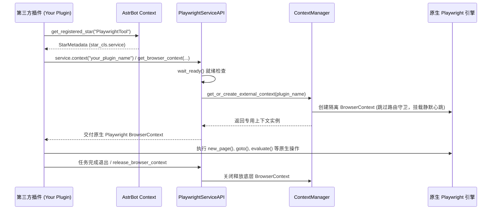

# 跨插件共享浏览器服务接入指南 (Playwright Service API)

`astrbot_plugin_playwright_tools` 作为 AstrBot 的浏览器能力基座，通过 AstrBot Star 动态寻址机制，向其他第三方插件提供稳定、高效且隔离的原生 `BrowserContext` 共享服务。

---

## 1. 接入理念与寻址方式

在 AstrBot 插件运行环境中，各个插件通常相互解耦，**不应（也无法）通过传统的 Python 静态 `import`** 引入其他插件的内部类。  
本插件遵循 AstrBot 标准的 Star 注册机制，将服务基座挂载于插件 Star 类实例的 `service` 属性上。其他插件通过 `self.context.get_registered_star("PlaywrightTool")` 即可获取服务句柄。



---

## 2. 外部共享上下文的核心机制

1. **多租户插件隔离 (Per-Plugin Isolation)**：
   每个外部插件根据传入的 `plugin_name` 独享各自专属的 `BrowserContext`，Cookie、缓存及 LocalStorage 相互隔离，互不串扰。
2. **受信后端网络豁免**：
   第三方插件属于平台受信的后端扩展代码，创建外部上下文时设置 `is_external=True`，**跳过挂载普通用户的 `_route_guard` 路由拦截守卫**。这既保障了第三方插件能自由调用各类业务接口与内外部资源，又避免了底层海量网络静态请求进入 Python 层的性能损耗。
3. **原生事件静默感知保活 (Silent Activity Tracker)**：
   基座自动在外部 `BrowserContext` 上挂载 `page`、`request`、`response` 事件监听。只要插件发起了网络请求或开启了标签页，上下文活跃时间便会自动刷新，避免长耗时自动化任务被后台定时器误判超时回收。
4. **并发防重与双重检查锁 (KeyedLock & Double-Checked Locking)**：
   多个协程同时为同一插件请求浏览器上下文时，底层通过插件粒度的互斥锁进行排队与状态复验，确保底层浏览器实例仅创建一次。
5. **独立空闲超时与周期回收**：
   外部插件可自定义超时时长（`idle_timeout_minutes`）。即使插件发生异常未显式释放，后台清理协程也会在超过预设时长后自动销毁游离的浏览器资源，防止内存泄漏。

---

## 3. 代码示例与调用范式

### 范式一：临时任务自动释放（推荐）

通过 `async with service.context(...)` 上下文管理器模式，在代码块执行结束（或抛出异常退出）后自动触发释放：

```python
from astrbot.api.star import Star, register
from astrbot.api import logger

@register("my_awesome_plugin", "Author", "我的自定义业务插件", "v1.0.0")
class MyAwesomePlugin(Star):
    async def fetch_page_title(self, target_url: str) -> str:
        # 1. 寻址 PlaywrightTool 插件基座
        star_meta = self.context.get_registered_star("PlaywrightTool")
        if not star_meta or not star_meta.star_cls:
            raise RuntimeError("未检测到 astrbot_plugin_playwright_tools 插件，请先安装并启用该插件。")

        service = star_meta.star_cls.service

        # 2. 异步上下文管理器安全调用 (离开代码块后自动回收)
        async with service.context("my_awesome_plugin", idle_timeout_minutes=5) as b_ctx:
            page = await b_ctx.new_page()
            await page.goto(target_url, wait_until="domcontentloaded")
            title = await page.title()
            logger.info(f"成功获取页面标题: {title}")
            return title
```

### 范式二：多阶段任务长生命周期复用

若需要跨多次消息或长期维持某个网站的登录会话：

```python
class LongRunningTaskPlugin(Star):
    async def get_shared_browser(self):
        star_meta = self.context.get_registered_star("PlaywrightTool")
        if not star_meta or not star_meta.star_cls:
            raise RuntimeError("请先启用 PlaywrightTool 插件")

        service = star_meta.star_cls.service
        
        # 获取或复用已有上下文，设置 30 分钟独立超时
        b_ctx = await service.get_browser_context(
            plugin_name="long_running_task_plugin",
            idle_timeout_minutes=30,
            clean=False  # 若设为 True 则强制销毁旧实例并新建
        )
        return b_ctx

    async def cleanup(self):
        star_meta = self.context.get_registered_star("PlaywrightTool")
        if star_meta and star_meta.star_cls:
            await star_meta.star_cls.service.release_browser_context("long_running_task_plugin")
```

---

## 4. API 完整参考 (`PlaywrightServiceAPI`)

| 方法 / 属性 | 类型 / 签名 | 说明 |
|---|---|---|
| `ready` | `bool` (property) | 底层浏览器引擎是否已就绪。 |
| `wait_ready(timeout=30.0)` | `async def (float) -> bool` | 等待引擎就绪，超时抛出 `TimeoutError`。 |
| `get_browser_context(...)` | `async def (plugin_name: str, idle_timeout_minutes: int \| None = None, clean: bool = False, timeout: float = 30.0) -> BrowserContext` | 获取专属原生 `BrowserContext`，按插件名复用。 |
| `release_browser_context(plugin_name)` | `async def (str) -> bool` | 主动释放并销毁指定插件的浏览器上下文。 |
| `context(...)` | `@asynccontextmanager async def (...) -> AsyncIterator[BrowserContext]` | 异步上下文管理器，支持退出代码块时自动执行释放。 |
